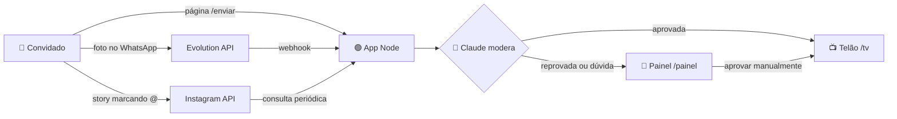

<div align="center">

# 📺🏡 Telão do Chá de Casa Nova

**Os convidados mandam fotos pelo WhatsApp (ou marcam o @ no Instagram), uma IA confere cada foto, e elas aparecem na TV da festa num carrossel animado.**


</div>

---

## ✨ O que ele faz

| | |
|---|---|
| 📲 **Recebe fotos** | Pelo WhatsApp (via Evolution API), por uma página web de envio (plano B, sem WhatsApp) ou por menções em story do Instagram |
| 🤖 **Modera com IA** | Cada foto passa pelo Claude antes de ir para a TV. Na dúvida, fica aguardando aprovação manual. Nada impróprio aparece na frente da família |
| 🎞️ **Telão animado** | Alterna sozinho entre destaque (uma foto por vez, com nome e recadinho), mural em movimento e parede de polaroides. Foto nova "invade" a tela com animação |
| 📅 **Separado por dia** | A festa tem dois dias (21 e 22). Cada foto fica no seu dia e o telão mostra o dia atual, o outro ou os dois |
| 🔐 **Painel do anfitrião** | Aprovar, tirar da TV, mudar configurações na hora, ver o status do WhatsApp e baixar as fotos do dia em `.zip` |
| 🖨️ **Cartaz para imprimir** | Página A4 com QR code e passo a passo, pronta para virar PDF |

---

## 🧭 Como funciona



O telão recebe as fotos novas em tempo real (Server-Sent Events). Se a rede cair, ele reconecta sozinho e continua de onde parou.

### 🗺️ As páginas

| Endereço | Para quê |
|---|---|
| `/tv` | O telão. Abra no navegador da TV e clique uma vez (ou aperte `f`) para tela cheia |
| `/painel` | Painel do anfitrião, protegido por senha |
| `/enviar` | Página de envio pelo navegador (plano B quando o WhatsApp não está ligado) |
| `/cartaz` | Cartaz A4 com QR code para imprimir |

---

## 🚀 Passo a passo

### 1️⃣ Pré-requisitos

- [Docker](https://docs.docker.com/get-docker/) com Docker Compose
- Uma chave da API da Claude, em [console.anthropic.com](https://console.anthropic.com) (sem ela, toda foto vai para aprovação manual)
- *(Opcional)* Um número de WhatsApp para parear na Evolution API
- *(Opcional)* Chromium/Chrome para gerar o PDF do cartaz

### 2️⃣ Baixar o projeto

```bash
git clone https://github.com/Behenck/tv-cha-de-casa-nova.git
cd tv-cha-de-casa-nova
```

### 3️⃣ Configurar o `.env`

```bash
cp .env.example .env
```

Abra o `.env` e preencha pelo menos:

| Variável | O que é |
|---|---|
| `ADMIN_PASSWORD` | Senha do painel `/painel` |
| `ANTHROPIC_API_KEY` | Chave da API da Claude, para a moderação automática |
| `PUBLIC_URL` | Endereço que os celulares dos convidados alcançam, ex.: `http://192.168.0.10:3000` (o IP da máquina na rede da festa) |
| `AUTHENTICATION_API_KEY` | Chave da Evolution API. Troque o valor padrão |
| `WEBHOOK_SECRET` | **Vazio** = WhatsApp desligado. Para ligar: `openssl rand -hex 16` |
| `EVOLUTION_INSTANCE` | Nome da instância do WhatsApp na Evolution |

> [!CAUTION]
> Nunca faça commit do `.env`. Ele já está no `.gitignore`.

### 4️⃣ Subir tudo

```bash
docker compose up -d --build
```

Isso sobe quatro serviços:

| Serviço | Porta | Papel |
|---|---|---|
| `app` | `3000` | O telão, o painel e a moderação |
| `evolution-api` | `8081` | Ponte com o WhatsApp |
| `postgres` | interno | Banco da Evolution |
| `redis` | interno | Cache da Evolution |

As fotos ficam guardadas no volume `app_data` e sobrevivem a reinícios.

### 5️⃣ Ligar a TV

No navegador da TV, abra:

```
http://<ip-da-máquina>:3000/tv
```

Clique uma vez (ou aperte `f`) para tela cheia. Sem fotos ainda, aparece a tela de boas-vindas com o QR code grande.

### 6️⃣ Testar antes da festa (sem WhatsApp, 5 minutos)

1. **Encha o telão com fotos de exemplo** para ver as cenas:
   ```bash
   docker compose cp scripts/fotos-exemplo.js app:/app/fotos-exemplo.js
   docker compose exec app node fotos-exemplo.js 18 21
   ```
2. **Teste o envio pelo navegador:** no painel → *Configurações* → *QR code leva para: Página de envio*. Leia o QR com o celular e mande uma foto. Ela aparece na TV em segundos (ou em *Aguardando* no painel, se não houver chave da Claude).
3. **Teste a moderação:** com rigor *Alto*, mande um print de tela. Ele deve cair em *Reprovadas*.
4. **Teste a remoção:** no painel, clique em *Tirar da TV* numa foto. Ela some do telão em até 5 s.
5. **Limpe os exemplos** antes da festa:
   ```bash
   docker compose exec app node fotos-exemplo.js limpar
   ```

### 7️⃣ Ligar o WhatsApp

> [!WARNING]
> A partir daqui, **toda foto enviada ao número pareado** passa pelo sistema, e quem mandar mensagem recebe as respostas automáticas. Se o número for pessoal, deixe *Recebimento: Pausado* no painel fora do horário da festa.

1. No `.env`, defina `WEBHOOK_SECRET` (com `openssl rand -hex 16`) e `EVOLUTION_INSTANCE`.
2. Reinicie o app:
   ```bash
   docker compose up -d app
   ```
3. Se a instância ainda não estiver pareada, abra o painel e leia o QR code do WhatsApp com o celular do número da festa.
4. O log deve mostrar `WhatsApp: instância e webhook prontos.` e o painel, *WhatsApp: conectado*.
5. De outro celular, mande uma foto com legenda. Ela aparece na TV com o primeiro nome e o recado, e o remetente recebe *"Recebemos sua foto!"*.
6. No painel, preencha o número do WhatsApp (55 + DDD + número) e escolha *QR code leva para: WhatsApp*.

### 8️⃣ Imprimir o cartaz

```bash
scripts/cartaz-pdf.sh http://localhost:3000 cartaz.pdf
```

Imprima em A4 e leia o QR impresso com o celular para conferir. Sem Chromium? Abra `/cartaz` no navegador e use *Imprimir → Salvar como PDF*.

### 9️⃣ Instagram *(opcional, experimental)*

Precisa de conta profissional e de um app na Meta com *Instagram Login*. Gere o token no painel da Meta e preencha `INSTAGRAM_TOKEN` e `INSTAGRAM_ID` no `.env`. Quando alguém marcar o @ num story com foto, ela aparece no painel/TV em até ~30 s.

> [!NOTE]
> Essa integração foi escrita a partir da documentação da Meta e ainda **não foi testada com uma conta real**. Se algo falhar, o erro aparece no painel (*Instagram: erro …*).

---

## 🎛️ O que dá para ajustar no painel

Tudo vale na hora, sem reiniciar nada:

- ⏱️ Tempo de cada foto na tela
- 📅 Dia exibido: automático, 21, 22 ou ambos
- 🛡️ Rigor da moderação: normal ou alto (alto reprova prints, memes e imagens da internet)
- ⏸️ Pausar o recebimento
- 💬 Textos das respostas automáticas
- 🔗 Para onde o QR code leva: WhatsApp ou página de envio
- 📦 Baixar as fotos aprovadas de cada dia em `.zip`

---

## 🛠️ Desenvolvimento

Rodar o app fora do Docker (Node 24+):

```bash
cd app
npm install
npm run dev     # recarrega ao salvar, lê o ../.env
npm test        # testes automáticos
```

Fora do Docker, o app procura a Evolution em `http://localhost:8081`.

### 📁 Estrutura

```
.
├── app/
│   ├── server.js       # servidor HTTP, rotas e eventos em tempo real
│   ├── ingest.js       # recebe a foto de qualquer canal e manda para moderação
│   ├── moderar.js      # moderação com o Claude
│   ├── whatsapp.js     # integração com a Evolution API
│   ├── instagram.js    # menções em story (experimental)
│   ├── db.js           # fotos e configurações
│   ├── dia.js          # em qual dia do evento cada foto cai
│   ├── test.js         # testes
│   └── public/         # telão, painel, cartaz e página de envio
├── scripts/
│   ├── fotos-exemplo.js  # popula o telão com fotos de teste
│   └── cartaz-pdf.sh     # gera o cartaz em PDF
├── specs/              # especificação, plano e tarefas do projeto
└── docker-compose.yml
```

---

## 🆘 Problemas comuns

| Sintoma | O que verificar |
|---|---|
| Foto não aparece na TV | Veja se ela está em *Aguardando* ou *Reprovadas* no painel. Sem `ANTHROPIC_API_KEY`, tudo fica aguardando |
| Celular não abre o QR | O `PUBLIC_URL` precisa ser o IP da máquina na mesma rede Wi-Fi dos convidados |
| WhatsApp não responde | `WEBHOOK_SECRET` vazio desliga o WhatsApp. Confira o log: `docker compose logs -f app` |
| Painel diz para definir senha | Preencha `ADMIN_PASSWORD` no `.env` e reinicie o app |

---

<div align="center">

Feito com 💛 para o chá de casa nova da Milene e do Denilson

</div>
